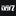

<p align="center">
  
</p>

<h1 align="center">WindowsGSM.DayZ</h1>

<p align="center">
  Run a DayZ dedicated server with WindowsGSM.
</p>

<p align="center">
  <a href="https://github.com/PapaGordon/WindowsGSM.DayZ/releases/latest"></a>
  <a href="https://github.com/PapaGordon/WindowsGSM/releases/latest"></a>
  <a href="LICENSE"></a>
</p>

This plugin installs and updates the official DayZ server through SteamCMD and runs it from WindowsGSM. Name, ports, player slots and mission come from the WindowsGSM settings. Passwords and gameplay settings stay in your server config, untouched.

**Using our [MeFriendos WindowsGSM](https://github.com/PapaGordon/WindowsGSM)?** Then you don't need this plugin. DayZ is built in there, with the same features. Just pick **DayZ Dedicated Server** under **Install**. This plugin is for other WindowsGSM builds.

## What it does

- Installs and updates the DayZ server (Steam app `223350`) with your Steam account.
- Keeps the server name, player slots and query port in the config in sync with WindowsGSM before every start.
- Passes game port, IP address and mission to DayZ.
- Leaves your passwords, gameplay settings, comments and mission classes alone and saves a `.bak` before it changes the config.
- Merges your mods into one list in the right order, without duplicates.
- Can keep a list of Workshop mods up to date before every start. [Workshop mods](WORKSHOP.md)
- Shows the DayZ log in **Embed Console**. Your DayZ window stays available through **Toggle Console**.
- Uses `DZSALModServer.exe` if you installed it.
- Asks DayZ to shut down cleanly before WindowsGSM ends it.

## What you need

- 64-bit Windows and a WindowsGSM build with the `SteamCMDAgent` and `SteamCMD.UpdateEx` plugin API. We test with the current [MeFriendos WindowsGSM](https://github.com/PapaGordon/WindowsGSM/releases/latest) (v1.25.4.9).
- A Steam account saved in WindowsGSM that can download the DayZ server. Anonymous download doesn't work for DayZ.
- Your mission and mod files.

The plugin signs in through WindowsGSM's own SteamCMD login. Encrypted Steam passwords (`steamPassEncrypted`) need MeFriendos WindowsGSM v1.25.4.2 or newer, and WindowsGSM has to run as the Windows user that encrypted the password. [Steam account and password](https://github.com/PapaGordon/WindowsGSM/blob/main/docs/operations/steam-credentials.md) Other builds only read the plain `steamPass` field. Updating this plugin can't change that.

## Install

1. Download the ZIP from the [latest release](https://github.com/PapaGordon/WindowsGSM.DayZ/releases/latest).
2. Copy the whole `DayZ.cs` folder into `<WindowsGSM>\plugins\`.
3. Click **Reload Plugins** or restart WindowsGSM.
4. Pick **DayZ Dedicated Server [DayZ.cs]** and click **Install**.
5. Set name, game port, query port, player slots and mission in WindowsGSM.
6. With the server stopped, set passwords and gameplay options in `servers\<server ID>\serverfiles\serverDZ.cfg`. The admin password starts empty, so set one before you use in-game admin tools.
7. Open your ports in the Windows firewall and on your router (see [Firewall](#firewall)).
8. Start the server and check the log in the profile folder.

## Settings

| WindowsGSM field | Default | Ends up in |
| --- | --- | --- |
| Server Name | The name you enter when installing | `hostname` in the config |
| Server IP | The host's local IPv4 address | `-ip` |
| Server Port | `2302` (UDP) | `-port` |
| Server Query Port | `2305` (UDP) | `steamQueryPort` in the config |
| Server Map | `dayzOffline.chernarusplus` | `-mission`, pointing to that folder in `mpmissions` |
| Server Max Players | `60` | `maxPlayers` in the config |

Change these in WindowsGSM, not in the config. Everything else you edit in the config while the server is stopped. Each new DayZ server gets ports 10 higher than the previous one. For Livonia, install the mission and set **Server Map** to `dayzOffline.enoch`. The mission from WindowsGSM wins over the `template` in the config.

New servers start with these parameters. WindowsGSM adds port, IP and mission itself. Add `-netLog` if you need network logs.

```text
-config=serverDZ.cfg -profiles=profile -doLogs -adminLog -freezeCheck
```

Own config and profile folders work too. Put paths with spaces in quotes:

```text
-config="config\dayz main.cfg" -profiles="profiles\main server" -doLogs -adminLog -freezeCheck
```

Create a custom config before you point `-config` at it, and give it its own name, because a Steam validation can overwrite `serverDZ.cfg`. The `.bak` only protects the config, so back up your mission storage yourself before updates.

## Mods

Copy the mod folders and their signing keys onto the server, then add the folders to **Server Start Param**:

```text
-config=serverDZ.cfg -profiles=profile -doLogs -adminLog -freezeCheck "-mod=@CF;@MyMod" "-serverMod=@ServerOnly"
```

Mods from `configs\DayZActivatedMods.cfg` are added to `-mod` in their order, without duplicates. `-serverMod` stays separate. Some WindowsGSM builds only offer **Manage Addons** for their own DayZ entry. If it's missing for this plugin, use the start parameters.

Without a Workshop list you install and update mods yourself. With one, the plugin downloads them before every start. [Workshop mods](WORKSHOP.md)

## Console and stopping

Turn on **Embed Console** and restart the server. The plugin then shows the current DayZ log (RPT) from the folder set with `-profiles`, including new log files and the last lines on shutdown. It adds `-doLogs` if it's missing. With `-noLogs` there's nothing to show.

The console only shows the log, DayZ doesn't take commands there. **Toggle Console** shows or hides DayZ's own window.

**Stop** sends CTRL+C and gives DayZ 30 seconds to shut down, then tries to close its window. Only if both fail does WindowsGSM end the process. For planned restarts with warnings for players, use DayZ's [messages.xml](https://community.bistudio.com/wiki/DayZ:Server_Messages) and check in the RPT log that the shutdown completes.

## Firewall

The plugin doesn't create or remove firewall rules. Use WindowsGSM's **Auto Firewall** if your build has it, or open the game and query ports yourself. Router port forwarding is always up to you.

If `DZSALModServer.exe` is next to DayZ, the plugin starts the server through it. With automatic firewall rules, both programs need a rule. MeFriendos WindowsGSM handles both. Delete the launcher to go back to the normal DayZ server.

## Troubleshooting

**SteamCMD says "No subscription".** The saved Steam account can't download app `223350`. Check the account in WindowsGSM.

**"Mission folder not found".** **Server Map** has to match a folder in `serverfiles\mpmissions` exactly, for example `dayzOffline.chernarusplus`.

**Name, slots or query port change back after editing the config.** These three always come from WindowsGSM. Change them there.

**Players can't connect.** Check game and query port, the IP, the Windows firewall and your router forwarding. Server and players also need the same game version and mods.

**A Workshop update is missing.** Look for a `[Notice]` line in the WindowsGSM log. [Workshop mods](WORKSHOP.md#if-something-goes-wrong)

## For developers

The plugin has to compile as C# 6, because that's what WindowsGSM uses for plugins. The tests live in the [WindowsGSM repository](https://github.com/PapaGordon/WindowsGSM/blob/main/docs/development/build-and-release.md#tests): `tests/BuiltInServers` and `tests/DayZConsole` compile this plugin and run the DayZ checks against it when you pass the path to `DayZ.cs\DayZ.cs`.

## Links

- [Releases](https://github.com/PapaGordon/WindowsGSM.DayZ/releases)
- [MeFriendos WindowsGSM](https://github.com/PapaGordon/WindowsGSM)
- [DayZ server configuration](https://community.bistudio.com/wiki/DayZ:Server_Configuration)
- [DayZ server messages](https://community.bistudio.com/wiki/DayZ:Server_Messages)
- [MeFriendos](https://mefriendos.de)

## License

[MIT License](LICENSE)
