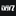

<p align="center">
  
</p>

<h1 align="center">WindowsGSM.DayZ</h1>

<p align="center">
  MeFriendos build for running a DayZ dedicated server with WindowsGSM.
</p>

<p align="center">
  <a href="https://github.com/PapaGordon/WindowsGSM.DayZ/releases/latest"></a>
  <a href="https://github.com/PapaGordon/WindowsGSM/releases/latest"></a>
  <a href="LICENSE"></a>
</p>

Installs and updates the official DayZ Server through SteamCMD. The name, ports, slots and mission come from the WindowsGSM settings. Your passwords and gameplay settings stay in the server config.

The [MeFriendos WindowsGSM fork](https://github.com/PapaGordon/WindowsGSM) already includes this DayZ implementation. Use its existing **DayZ Dedicated Server** entry. This separate plugin remains available for other compatible WindowsGSM builds.


## WindowsGSM and Steam login

Use the [latest MeFriendos WindowsGSM release](https://github.com/PapaGordon/WindowsGSM/releases/latest). This server is already built into that fork, so select its normal built-in entry there. The standalone plugin remains available for other compatible WindowsGSM builds.

This plugin uses WindowsGSM's central SteamCMD installer for account login. On MeFriendos WindowsGSM v1.25.4.2 or newer it accepts both legacy plaintext credentials and the encrypted `steamPassEncrypted` field. Run WGSM under the Windows user that encrypted the password. [Password setup](https://github.com/PapaGordon/WindowsGSM/blob/main/STEAM-CREDENTIALS.md). Other forks need their own support for this encrypted format; updating this plugin cannot add it to an older host.

The plugin leaves firewall management to the host. On other WindowsGSM builds, configure game/query port rules manually if the host does not manage them. Router forwarding is separate.

## Features

- Uses the DayZ wordmark for the server list and the MeFriendos logo as the author icon.
- Installs and updates Steam app `223350` with the configured Steam account.
- Synchronizes the server name, player slots and Steam query port before each start.
- Passes the configured game port, IPv4 address and mission to DayZ.
- Supports config and profile paths with spaces.
- Keeps existing passwords, gameplay settings, comments and mission classes.
- Backs up changed configs to `.bak` and leaves unchanged files alone.
- Combines manual and selected mods into one ordered list without duplicates.
- Uses `DZSALModServer.exe` when installed, or the normal DayZ executable otherwise.
- Displays the active DayZ RPT in Embed Console and keeps the native window available through Toggle Console.
- Tries CTRL+C before WindowsGSM's final stop fallback.
- Leaves firewall management to WindowsGSM.

## Quick overview

| Setting | Value |
| --- | --- |
| SteamCMD App ID | `223350` |
| Executable | `DayZServer_x64.exe` |
| Optional launcher | `DZSALModServer.exe` |
| Default config | `serverDZ.cfg` |
| Default profile folder | `profile` |
| Game port | `2302/UDP` |
| Query port | `2305/UDP` |
| Port increment | `10` |
| Player slots | `60` by default |
| Default mission | `dayzOffline.chernarusplus` |
| SteamCMD login | Configured Steam account |
| Server query | A2S |
| Console | Embedded RPT output and native DayZ window |

The default additional parameters are:

```text
-config=serverDZ.cfg -profiles=profile -doLogs -adminLog -freezeCheck
```

WindowsGSM adds the game port, bind address and mission path. Add `-netLog` when you need network logging. No CPU count or mods are forced into the defaults.

## Requirements

- 64-bit Windows and a compatible WindowsGSM build.
- A configured Steam account with access to the DayZ Server files.
- The mission and any mod files you want to use.

The plugin was checked against MeFriendos WindowsGSM v1.25.4.1. Other builds need the `SteamCMDAgent` and `SteamCMD.UpdateEx` APIs used by this plugin. Game files and mods are downloaded separately.

## Installation

1. Download the plugin ZIP from [Releases](https://github.com/PapaGordon/WindowsGSM.DayZ/releases/latest).
2. Extract the complete `DayZ.cs` folder into `<WindowsGSM>\plugins\`.
3. Click **Reload Plugins** or restart WindowsGSM.
4. Select **DayZ Dedicated Server [DayZ.cs]** and run **Install**.
5. Set the name, game port, query port, player slots and mission in WindowsGSM.
6. While stopped, edit `servers\<id>\serverfiles\serverDZ.cfg` for passwords and gameplay settings.
7. Set up Windows firewall rules and router forwarding for your ports.
8. Start the server and check the logs in the profile folder.

The Steam account setup is shared with WindowsGSM. It can reuse saved credentials, so an existing installation may not ask for them again. This plugin uses account login for both installation and updates.

## Settings and configuration

| WindowsGSM field | DayZ setting |
| --- | --- |
| Server Name | `hostname` in the selected config |
| Server IP | `-ip` |
| Server Port | `-port` |
| Server Query Port | `steamQueryPort` in the selected config |
| Server Map | `-mission`, pointing to the folder under `mpmissions` |
| Server Max Players | `maxPlayers` in the selected config |

Change these values in WindowsGSM. Edit other options directly in the selected config while the server is stopped. The initial admin password is empty; set your own before using in-game administration.

For Livonia, set **Server Map** to `dayzOffline.enoch` once that mission is installed. The launch mission takes precedence over the `template` value left in the config.

Custom paths work, including spaces:

```text
-config="config\dayz main.cfg" -profiles="profiles\main server" -doLogs -adminLog -freezeCheck
```

A custom config must already exist. Give it a separate filename because SteamCMD validation can replace the shipped `serverDZ.cfg`. A `.bak` file protects the previous config; back up your mission storage separately before updates.

## Mods

Install the mod folders and signing keys, then add their names to **Server Start Param**:

```text
-config=serverDZ.cfg -profiles=profile -doLogs -adminLog -freezeCheck "-mod=@CF;@MyMod" "-serverMod=@ServerOnly"
```

An existing `configs\DayZActivatedMods.cfg` is merged with `-mod`, keeping the order and removing duplicates. `-serverMod` stays separate. Without WorkshopMods.cfg, install and update mod files yourself. Optional pre-start downloads are described in [Workshop updates](WORKSHOP.md).

The MeFriendos fork keeps its built-in DayZ Addons UI. Other WindowsGSM builds may only offer that UI for their original DayZ entry; use the start parameters when it is unavailable.

## Firewall and DZSA

The plugin does not create or remove firewall rules. Use WindowsGSM's **Auto Firewall** setting or your own port rules. Router forwarding is a separate step.

If you install `DZSALModServer.exe` beside DayZ, the plugin uses it automatically. Both executables need their application rules when using automatic firewall handling. MeFriendos WindowsGSM v1.25.4.1 manages both paths centrally. Remove the launcher to return to the normal DayZ executable.

## Console and stopping

Enable **Embed Console**, then restart the DayZ server. The plugin follows the active DayZ RPT in the folder selected by `-profiles`, including new log files and final shutdown lines. It adds `-doLogs` for this mode when missing. Remove `-noLogs` if you want RPT output.

This is a log view, so it does not accept server commands. The native DayZ window remains available through **Toggle Console**.

Stop first sends CTRL+C and waits up to 30 seconds. It then tries closing the native window. WindowsGSM can still force the process to stop if neither works. For scheduled shutdowns with player warnings, use DayZ's [messages.xml mechanism](https://community.bistudio.com/wiki/DayZ:Server_Messages) and check the RPT log for a completed shutdown.

## Troubleshooting

### SteamCMD reports No subscription

Check the Steam account configured in WindowsGSM and its access to app `223350`. The anonymous download check returned this error; the plugin uses account login.

### Mission folder not found

Check **Server Map** and the matching directory under `serverfiles\mpmissions`. Enter the folder name, for example `dayzOffline.chernarusplus`.

### Name, slots or query port revert after editing the config

These three values follow the WindowsGSM fields. Change them there before the next start.

### Players cannot connect

Check the configured game/query ports, bind address, Windows firewall rules and router forwarding. Also confirm that the server and clients use matching game versions and mods.

## Validation

The checks in the fork's `tests/BuiltInServers` project cover registration, existing plugin names, icons, config preservation, backups, invalid input and Windows argument parsing. They also compile this plugin as C# 6 and run the same DayZ config checks against it.

The fork's `tests/DayZConsole` checks cover RPT updates, UTF-8 text, log rotation, final output and hidden-window handling for both the built-in server and this standalone plugin.

## Links

- [Plugin releases](https://github.com/PapaGordon/WindowsGSM.DayZ/releases)
- [MeFriendos WindowsGSM](https://github.com/PapaGordon/WindowsGSM)
- [DayZ server configuration](https://community.bistudio.com/wiki/DayZ:Server_Configuration)
- [DayZ server messages](https://community.bistudio.com/wiki/DayZ:Server_Messages)
- [MeFriendos community](https://mefriendos.de)

## License

Made by PapaGordon for MeFriendos. See [LICENSE](LICENSE).
## Workshop updates before start

Optional: create a per-server WorkshopMods.cfg to download and stage configured mods before each start. Steam subscriptions alone do not update server mod folders. See [setup, backups and recovery](WORKSHOP.md). Unlisted mods are kept. The updater is included in this plugin and uses the host's SteamCMD login handling.
